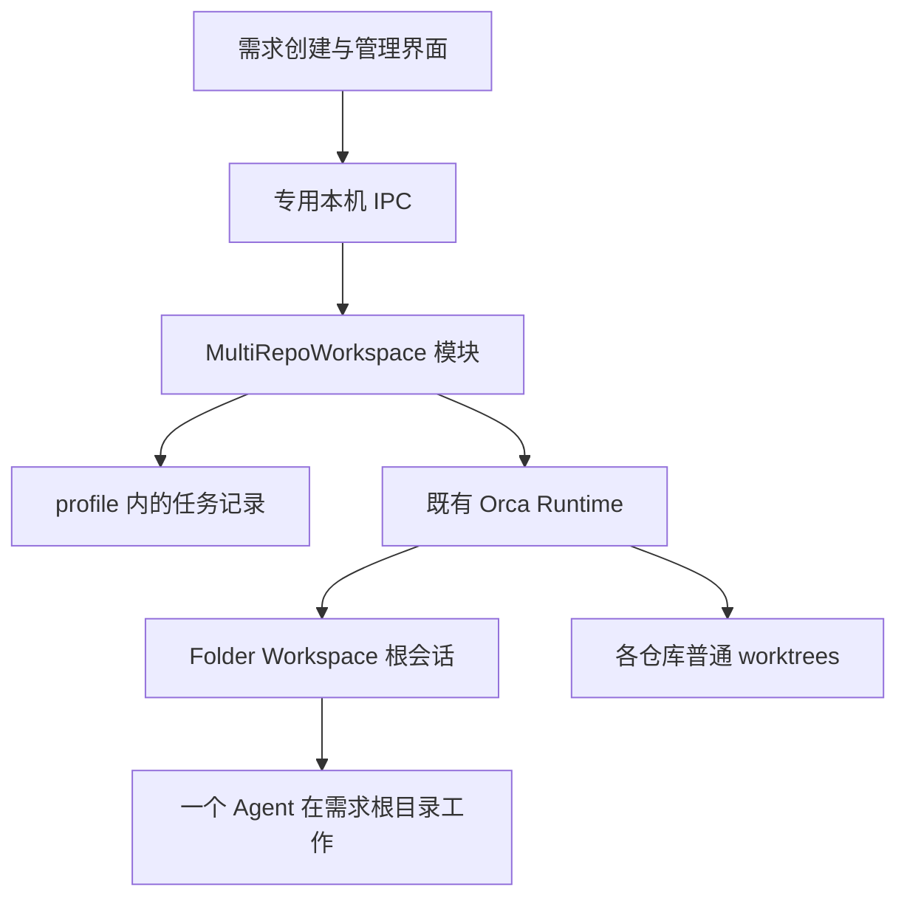

# Orca 34：多仓库需求工作区设计与实施计划

原设计日期：2026-10-16，设计已批准。本文保留设计基线与阶段定义；当前实现/验证状态见[完成审计](fork-multi-repo-completion-audit.md)，用户操作见[人工验收步骤](fork-orca34-manual-acceptance.md)。

用户已确认第一版范围：本机 Git 仓库；一个 Agent 在需求根目录同时修改多个仓库；SSH/WSL 后续扩展。维护目标为 [34/orca](https://github.com/34/orca)，尽量新增独立文件，保留跟随官方更新的能力。

## 1. 基线与结论

查询时 fork `main` 为 `b16a71c7fb044af96b29dc2a2c4f86ee7b9d0122`；当前本地工作树为 `12a1128afe6a127060dea1e35605dfe09d5b6425`，分支 `34/multi-repo-workspace-management`。GitHub compare 显示 fork 比本地领先 47 个提交；当时官方 main 又比 fork 领先 3 个提交、没有反向提交，说明 fork head 是官方 main 的祖先。这只是查询时快照，不将活动 main 作为可复现版本号。

准备阶段已保留 `origin` 指向 `stablyai/orca`，新增 `fork` 指向 `34/orca`。最终开发基线锁定 fork main 的 `b16a71c7fb044af96b29dc2a2c4f86ee7b9d0122`，使用本地分支 `34/multi-repo-workspaces-v1`。最新 release `v1.4.227` 与已分析主线存在大幅分叉，缺少本方案引用的 Runtime 拆分和 macOS daemon 文档，因此不将其直接作为开发基线。保留原分支，不改用户既有历史；后续采用包含这些能力且验证兼容的官方提交或 release。具体环境和执行进度见 [Goal 交接](fork-multi-repo-workspaces-goal.md)。

采用内置的 **MultiRepoWorkspace 模块**，产品显示为“多仓库需求工作区”。它负责任务成员、创建、恢复与清理；既有 Folder Workspace 承载根目录会话，普通 worktrees 承载每仓库的 Git 身份。仓库可来自不同现有项目组，不要求物理上放在同一个父目录，也不移动它们的项目分组。

当前插件声明只有 workspace:read、terminal:send、storage 等能力，没有可靠的工作树创建/删除授权接口。为了一个功能扩大通用插件权限，反而增加上游冲突和维护范围，因此不作为第一版路线。[插件能力](../../src/shared/plugins/plugin-capabilities.ts)

## 2. 用户工作流与第一版交付范围

主入口为现有新建区域中的“新建多仓库需求工作区”；也加入命令面板。打开独立表单，复用现有 UI primitives 和仓库多选控件。

表单包括需求名称、任务说明、仓库多选、各仓库起始 ref、分支名、现有 Agent 选择器、各仓库 setup 选择。高级项展示生成后的目标目录和可选成员短名。默认分支使用任务短标识加不可变短 ID，避免同名需求冲突；允许提交前按仓库修改。仓库必须已注册且属于当前本机，跨组可选。

提交前显示完整计划；创建开始后展示各仓库的阶段和实际错误。窗口关闭不意味着后台任务已取消。创建完毕进入普通 Folder Workspace，根目录就是本需求目录，Agent 从这里启动。

日常界面继续使用 Explorer、编辑器、终端/原生 Chat、Attached worktrees 和 PR Checks。成员工作树仍可在原项目下打开；不为“看起来整齐”把它们从现有视图隐藏。需要 Git 操作时进入相应成员，根工作区不伪装成一个 Git 仓库。

第一版交付包含：创建任意本机仓库子集、独立 worktrees、一个根 Agent、进度和失败重试、重启恢复、归档、受保护的逐成员清理、可回退的本机安装包。

第一版暂不包含：SSH/WSL/远端 runtime、将不同主机拼成一个根目录、统一 commit/merge、动态增删已运行任务的成员、导入已有分支/worktrees 为任务成员、额外启动每仓库 Agent、完整的跨仓 Source Control 重写。任务创建后成员集合固定；新需求可选择另一组合。普通单仓库/文件夹工作区保持现有行为。

## 3. 目录与隔离

```text
<本机需求工作区根>/
  req-123-a1b2c3/
    TASK.md
    .orca-multi-repo.json
    api/                    # api 仓库的真实 linked worktree
    web/                    # web 仓库的真实 linked worktree
  req-124-d4e5f6/
    TASK.md
    .orca-multi-repo.json
    api/                    # api 的另一条需求分支
    admin/
```

根目录优先放在已有全局绝对 workspaceDir 的专用子目录；若现有设置是仓库相对路径，首次使用要求选择明确的本机绝对父目录，记录在模块自己的 profile 配置中。不能临时修改 repo.worktreeBasePath 或全局设置来偷渡本次目标路径。路径建议属于创建计划，实施时验证每仓库的自定义路径策略不会意外覆盖它。

每个成员使用真实目录，不通过 symlink 指回原 checkout。任务 ID、根目录和成员目录创建后保持不变；重命名只改显示名称。成员短名由主机校验，处理大小写不敏感冲突、Windows 保留名、路径长度、同名仓库和 `..`；不能靠展示名称拼接任意绝对路径。

根目录不执行 git init。`TASK.md` 提供需求说明、成员目录、起始 ref/commit、各仓库开发规范入口和操作约定。现有 Agent 启动提示引用它，不覆盖仓库 AGENTS.md/CLAUDE.md，也不全局修改 Agent 配置。

源文件隔离不代表依赖、端口、数据库也隔离：复用 Orca 已有 setup、shared paths、.worktreeinclude 策略并展示结果。用户配置的共享目录仍可能是链接，不能声称整个运行环境互不影响。

Agent 从根目录启动时，必须验收“可编辑各成员 + 可执行成员 Git 操作”。linked worktree 的 Git 管理目录在原仓库，根目录可读写并不自动证明其 Git metadata 可写。沿用 Orca 对现有 Agent/Folder Workspace 的授权方式，按明确的成员授权；不通过关闭 sandbox 或全盘放权解决。不同 Agent 的会话适配不另写一套。

## 4. 模块与接入点



只实现真实存在的一种执行方式：本机 Adapter。它连接模块和已有 Runtime，不复制 Git 命令执行、终端启动、Agent 状态、setup 或删除逻辑。未来需要 SSH 时再增加 host RPC 接入，不提前建立通用插件/执行框架。

建议文件布局如下，按责任拆分，不预先为每个概念制造空文件：

```text
src/shared/multi-repo-workspaces/
  multi-repo-workspace-contract.ts       # 校验 schema、请求、结果和状态

src/main/multi-repo-workspaces/
  multi-repo-workspace-service.ts        # 创建、重试、清理的统一入口
  multi-repo-workspace-plan.ts           # 选仓、ref、分支、目录预检
  multi-repo-workspace-store.ts          # profile 记录与持久化版本
  multi-repo-workspace-recovery.ts       # 记录与真实 Git/目录核对
  multi-repo-workspace-removal.ts        # 清理预览、所有权、逐项执行
  multi-repo-workspace-runtime.ts        # 连接已有 Runtime 的 Adapter
  multi-repo-workspace-ipc.ts            # 当前窗口/参数/主机校验

src/preload/api/multi-repo-workspaces-bridge.ts
src/renderer/src/features/multi-repo-workspaces/
  MultiRepoWorkspaceCreateDialog.tsx
  MultiRepoWorkspaceManager.tsx
  multi-repo-workspace-client.ts
  multi-repo-workspace-state.ts

config/forks/orca34/
  electron-builder.cjs
  build-local.mjs
```

测试与实现相邻；接口应同时是调用方和测试的入口，内部逻辑拆分不要求全部导出。renderer 只缓存展示和操作进度，不成为持久化权威。

主要 Interface 为 `list/get`、`create`、`retry`、`previewRemoval`、`remove`。创建请求带稳定 requestId，返回 taskId 后由任务记录追踪结果；重试针对同一 taskId，不重新生成任务。普通打开/改名/归档/Agent 启动沿用现有接口。是否需要取消剩余成员的入口在创建阶段验证；如提供，含义是停止下一步，不强杀正在写 Git 的步骤，也不自动删除已完成成员。

**无法完全避免的现有文件修改**：

| 接入点                       | 最小改动                                                               | 不改变的行为                                       |
| ---------------------------- | ---------------------------------------------------------------------- | -------------------------------------------------- |
| Runtime 创建请求与路径选择   | 新增仅主进程内部使用的 task/member placement；按登记计划选精确目录     | 未携带该字段的普通创建、名称避让、远端路由保持原样 |
| 创建 materialization         | 写入真实创建布局，沿用元数据、共享文件和缓存失效；任务成员保留分支策略 | 原有 worktree 身份和 Git 面板不分叉                |
| 预创建 checkout 缓存         | 任务 placement 第一版明确不使用该加速路径                              | 普通创建继续使用，不能让缓存移动到未经授权的目录   |
| main/preload 初始化          | 注册专用 IPC、类型和 profile 生命周期                                  | 不给 renderer 新增裸路径 Git 执行能力              |
| 新建入口、命令面板、任务菜单 | 挂载独立对话框/管理界面；任务根展示相应操作                            | 不重写全局 sidebar 分组算法                        |
| profile 切换和恢复           | 绑定创建时的 profile/host；恢复未完成记录                              | 不把旧 profile 的异步结果写到新 profile            |
| fork 构建身份和 updater      | 自用构建走独立身份/数据目录/更新策略                                   | 官方构建默认行为不变                               |

初步预计修改约 10–20 个现有文件，另加模块实现与测试；这是规划范围，不是硬性行数指标。若需要大面积重写 runtime 继承链、sidebar 或状态数据库，先回看方案，不以“都放在新文件”为理由复制上游实现。

复用依据：

- [Runtime 创建入口](../../src/main/runtime/workspaces/workspace-creation.ts)
- [本地 worktree 创建](../../src/main/runtime/runtime-local-worktree-create.ts)
- [创建目录与分支候选](../../src/main/runtime/runtime-local-worktree-create-candidate.ts)
- [共享文件和元数据 materialization](../../src/main/runtime/runtime-local-worktree-materialization.ts)
- [预创建缓存消费](../../src/main/runtime/runtime-local-git-worktree-create.ts)
- [Folder Workspace](../../src/main/runtime/runtime-project-group-controller.ts)
- [工作树删除](../../src/main/runtime/workspaces/workspace-removal.ts)
- [仓库多选控件](../../src/renderer/src/components/ui/repo-multi-combobox.tsx)

第一版只增加本机 IPC，不扩展公共 worktree.create 的 wire schema 来接收任意路径。IPC 同样验证 sender、输入及当前 host。main 内部 placement 只引用 taskId/memberId，目标路径由服务读取已验证计划计算。第一版不公开到旧 SSH/WSL 主机；将来增加专用 RPC 和 capability 握手，旧主机不支持就明确拒绝，不静默退回普通创建。

## 5. 数据所有权与恢复

普通 Folder Workspace、worktree 元数据、lineage、PR/MR、Agent 状态继续由上游存储负责。一个专用 folder-backed Project Group 用于展示任务根；它只包含任务 Folder Workspaces，不重新归组用户的 repo。每个任务的 Folder Workspace.folderPath 指向实际任务根，成员通过 parent lineage 关联。

模块独有信息放在当前 profile 目录下，例如 `multi-repo-workspaces/tasks/<taskId>.json`。每任务一个带 schemaVersion/revision 的记录，保存：taskId/requestId、绑定 profile/host、根路径、Folder Workspace ID、成员 repoId/实际 Git 身份、短名、请求 base ref/解析 commit、任务分支、计划目录、已创建 worktreeId/instanceId、创建与清理步骤及错误。

只记录跨仓协调需要的数据，不镜像 Git dirty、PR check、Agent live 状态。模块创建状态与业务“需求已完成”分开；`ready` 只代表所需 checkout 和登记已完成，setup 失败/警告单独显示，不能表示测试已通过。

用已有 [durable-file-write](../../src/main/durable-file-write.ts) 的 fsync/rename 能力写入，不另写数据库、日志平台或通用事务系统。操作按任务串行，文件名和临时文件使用既有惯例；profile 生命周期中只允许一个明确的执行 owner。

根目录 `.orca-multi-repo.json` 是可导出的描述/所有权佐证，不是删除授权来源。Agent 可编辑任务根，因此任何从该文件读到的路径都需与 profile 记录、实际 Git worktree/common-dir/instance 身份重新核对。仅凭 marker 存在不能递归删除目录。

模块 journal 与上游 store 不具备跨文件原子事务。采用“先持久化意图 → 执行一步 → 记结果 → 核对”的方式，逐步收敛；不假装一次 rename 能同时提交两套存储。

上游发生外部操作时：单独删除成员只会标为缺失/需要处理，不自动重建它；删除父 Folder Workspace 解释为移除入口，保留任务文件；删除整个项目组也不递归删除任务根。管理界面可列出未挂接记录，用户明确恢复入口或保留文件后移除记录，启动时不会自动复活用户删掉的 UI。

## 6. 创建和失败处理

1. 预检全部成员：当前 profile、native-local 主机、Git 身份、重复 common-dir、base ref、分支和目录冲突、setup 选择。folder repo、SSH、WSL、远端 runtime 明确拒绝。
2. 创建稳定 taskId，持久化全部成员的计划。根目录用独占创建，不能合并到已有非空目录。检查真实父路径及 symlink/junction 替换风险。
3. 在执行前解析并记录各成员的起始 commit；重复执行同一任务沿用它。利用现有 baseBranch/compareBaseRef 能力区分实际起点和用于展示/比较的 ref，实施时验证不会被后台 fetch 偷换起点。
4. 逐成员调用现有 Runtime 创建。第一版顺序执行，复用既有 Git 并发限制；无额外无界 Promise.all。task 模式精确匹配已记录分支和目录，冲突即停，不用普通创建的自动后缀机制悄悄改名。
5. 立即登记普通 worktree/lineage、实际布局和分支保留策略，再运行已有文件准备和 setup。创建记录须能区分 Git 成功、元数据失败、setup 失败，不重复 git worktree add。
6. 所有成员 checkout 完成后生成任务说明，打开根 Folder Workspace，通过现有 Agent 启动入口启动一次根 Agent。需要的 setup 未结束/失败时不宣称就绪；用户可按现有策略明确跳过后继续。子成员不自动启动额外 Agent；setup 所需终端仍按上游机制运行。

批次部分失败保留成功成员，展示哪个仓库在哪一步失败；不自动 `reset --hard`、`git clean`、强删目录或删除分支。主进程崩溃/丢失回复后，以 requestId/taskId 找回同一任务；如果 Git 已创建而登记未写入，核对精确路径、common-dir、任务分支与持久化意图后再恢复登记。证据不足则标为需要处理，绝不把未知目录当空目录重新创建或删除。

Agent 启动失败独立于 checkout 创建失败：只重试根会话启动，不重建所有工作树。重启恢复不自动重新发送初始需求给已有 Agent，避免重复执行任务。

## 7. 清理与归档

归档先复用 Folder Workspace 的归档行为，保留目录、分支和成员。任务完成不等于所有 PR 已合并，界面不自动同步每个成员的业务状态。

“清理需求工作树”先生成逐成员预览：目录/身份是否匹配、dirty/untracked/ignored 内容处理、分支保留、运行中的根会话与成员服务、上游已有删除保护。确认前展示明确结果；执行时重新核验，不能只信预览缓存。

根 Agent 可能写任何成员，所以必须先处理根会话及其进程，再逐成员调用已有 `removeManagedWorktree`，不只停止成员终端。复用现有停机/删除验证，对 `unverifiable` 不当作 `exited`，普通批次不隐含 force。

任务成员默认保留分支，复用已有 `preserveBranchOnDelete` 元数据；确保此策略在登记时写入并在崩溃恢复后仍成立。未推送提交不能因任务清理丢失；后续删分支仍走现有明确操作。

删除 API 的 accepted/removing 不等于删除完成；等待后台删除真正结束再记成员已移除。某成员失败则保留任务记录和剩余成员，支持继续处理。

最后只删除模块明确生成且未被用户修改的元文件，再对空根目录 rmdir。根下若还有用户新增文件、修改过的 TASK.md、日志、未知目录，则保留根目录并告知原因。禁止对任务根无条件 `rm -rf`。恢复期间不自动继续破坏性清理，重新核验并由用户继续。

## 8. 与上游保持可合并

本地保留 `origin` 指向官方；已增加 `fork` 指向 `34/orca`，所有推送显式指定 fork。Git remote 在各 worktree 间共享，不为了本功能重命名全仓 origin。

分支策略：`34/orca:main` 保持官方镜像，`34/local` 是自用集成分支，`34/multi-repo-workspaces-v1` 为功能分支，原 `34/multi-repo-workspace-management` 保留。集成和功能分支当前仅在本地准备。自用代码只合入 `34/local`；发布记录保留 upstream tag/SHA、fork SHA、构建架构和本地 schema 版本。

新增文件集中在功能目录，但承认少数核心接入点必须改。将“内部目标目录支持”“需求模块”“界面”“自用构建”拆成可独立审查的提交，不复制整个 create/delete 函数，不维护自动字符串打补丁脚本，不在 upstream main 散落条件分支。

只参考 [#9491](https://github.com/stablyai/orca/pull/9491) 的真实目录、恢复和删除所有权设计；不直接合入其全部提交。已有的 Folder Workspace/lineage 能力先复用，避免再造 Missions、Fleet、统一 SCM 三套并行模型。

每次选择官方稳定 tag，在临时 sync 分支合并到自用集成分支，解决冲突，运行相关验证后生成候选包。已发布集成分支不反复 rebase/force-push；未发布功能分支可以在干净基础上整理。GitHub 合并仍遵守仓库规则：精确 head 的完整 PR workflow 与 aggregate gate 必须通过，不以另一个绿色检查代替，不绕过失败 gate。

维护文档包含接入点、为什么需要、回归测试、官方等价功能出现后的删除条件。本文件位于现有允许跟踪的 docs/readme 下，避免普通 docs/** 被忽略导致设计只留在本机。

## 9. 本机运行、打包与回退

先用现有 `pnpm dev` 和独立 ORCA_DEV_USER_DATA_PATH 完成试验。执行测试与代理启动始终带 ORCA_BACKGROUND_LAUNCH=1。只用试验仓库验证早期阶段，不复制正式 profile 数据来试迁移。

可安装版本暂定 `Orca 34`，独立 bundle ID、应用数据目录、URL scheme 和对外 CLI 名称。复用现有 profile 内 terminal wrapper，让 Agent 调用的 orca 路由到本实例；不覆盖用户全局官方 CLI。独立数据目录不代表所有 Agent 登录、外部工具配置和源仓库也都隔离。

新 fork builder 配置继承上游配置并覆盖有限身份/产物字段，不复制几百行配置。打包回调、helper、Keychain、daemon/socket、URL scheme 和 updater 均需核对实际身份；不能只改 productName。macOS helper/TCC 关系按 [macOS daemon 文档](../reference/macos-daemon-tcc-attribution.md)验证，不能为了安装成功关闭签名校验或假冒官方签名身份。

第一版手动安装自编译包，不自动从官方 feed 替换 fork；updater 政策放在小的构建身份模块，普通官方构建不受影响。等手动安装和回退稳定后，再考虑 fork 自己的更新 feed，不把它作为本功能前置项目。

Node/pnpm/Bun 版本均读取所选 upstream checkout 的固定版本。mac 默认双架构构建先运行 pnpm install:release；先验收本机架构，再扩展产物。自用版本号、产物名、构建清单明确标识上游基线和 fork 迭代，不使用虚高官方版本号避免未来降级困难。

每次升级保留上一份安装包、升级前关闭应用后的 profile 备份及任务清单。失败时恢复匹配的旧包和旧应用数据，保留 Git 工作目录；不让旧版直接写新版应用数据库。新模块读到高于自己支持的 schemaVersion 时只读或拒绝修改，不静默覆盖。

官方未来补齐功能后，优先让官方接管标准 Git 成果：提交/推送，导出任务→仓库→分支→目录→PR/MR，对现有 worktrees 重新登记或按原分支创建官方工作区。自用 JSON 不是未来官方 schema；会话历史和任务 UI 不保证自动迁移。不再需要时删除整个功能目录并撤回登记/路径接入点。

## 10. 实施阶段与验收

| 阶段              | 交付                                                                                         | 通过条件                                                                                                  |
| ----------------- | -------------------------------------------------------------------------------------------- | --------------------------------------------------------------------------------------------------------- |
| P0 基线与接入验证 | 锁定 tag/SHA、fork remote/分支策略；独立 dev profile；验证目标目录、授权、sidebar 和构建身份 | 两个试验仓库可在共同根真实创建；根 Agent 可编辑与执行成员 Git；普通创建无回归；列出确切需要改的现有文件   |
| P1 最小端到端     | 独立模块、任务记录、专用 IPC、简单创建表单、根 Folder Workspace 和 Agent                     | 同一仓库同时参与 A/B 两需求且文件不串；第二仓来自不同项目组；Agent 只启动一次；根 Explorer 能访问全部成员 |
| P2 失败与恢复     | 稳定 requestId、逐步记录、故障恢复、setup/启动分离                                           | 双击/丢响应不重复创建；第二仓失败可重试；每个关键步骤强制退出后不覆盖内容、不重复启动 Agent               |
| P3 清理与管理     | 管理界面、归档、清理预览、保留分支、外部改动对账                                             | dirty/未跟踪/未知文件不丢；根 Agent 被正确处理；删除部分失败可继续；用户手动删成员/入口不被自动复活       |
| P4 可安装自用版   | 独立身份、手动更新策略、构建清单、安装和回退说明                                             | 与官方版数据/CLI/daemon 不串；本机签名/权限路径可用；升级和回退演练通过；不改变官方构建默认               |
| P5 上游同步演练   | 合并下一选定官方 tag 的候选分支及包                                                          | 接入点冲突可局部解决，相关验证和完整 PR gate 通过，已有多仓任务仍能打开/清理                              |

P1 是可体验版本，P3+P4 才是日常使用的第一版；不能把缺少恢复/清理保护的演示版当交付完成。P0 先解决目录与 Agent 权限这两个最可能扩大范围的问题，再确定细化工期。

## 11. 测试与完成标准

主要测试跨模块 Interface，避免只给内部函数写镜像断言。使用临时真实 Git 仓库覆盖目录与 worktree 身份；用可控失败点覆盖持久化/恢复；平台差异按现有 runtime path 与 process-host 约定处理。

- 主流程：api+web 和 api+admin 两个并行需求；不同 base ref；原 checkout 保持不变；根 Agent、Explorer、成员 diff、GitHub/GitLab review 保持各自正确上下文。
- 创建边界：同名仓库、大小写冲突、空格/中文路径、Windows 保留名、已有分支、已有非空目录、重复同一 Git common-dir、setup ask/失败、原仓库含未提交修改、每仓自定义 worktree 路径。
- 一致性：Git 已成功而 journal/store 任一失败；丢响应重试；重复 IPC；profile 切换；外部手动 git worktree remove/move；marker 被编辑；新 schema 拒绝旧 writer。
- 清理：根 Agent 正在写成员、成员服务存活/无法确认退出、未跟踪/忽略文件、未推送提交、根用户笔记、部分删除、后台删除尚未完成、无匹配所有权证据。
- 兼容：不支持的 SSH/WSL/远端 target 在任何写入前拒绝；未开启功能的普通创建/删除行为不变；不新增高于 Git 2.25 的必需命令选项；Mac/Linux/Windows 路径规则均有覆盖，实际首发安装验收以用户 macOS 为主。
- UI：按 STYLEGUIDE 使用现成 tokens/primitives；键盘、长任务进度、重试与错误、深浅色；隐藏 renderer 的 Playwright CDP 验证，不抢占用户桌面。native focus 测试在隔离显示或 CI 执行。

相关测试、pnpm tc、changed code quality gate 先跑；发布候选执行仓库要求的完整 PR 检查。所有代理启动与测试带 ORCA_BACKGROUND_LAUNCH=1，启动策略修改必须重建后再运行。若 Electron skill 不在当前技能目录，实施 UI 检查前按仓库要求查找它；无法取得时明确报告验证缺口，不用 computer-use 替代。

## 12. 设计评审时完成与未做事项（历史）

已核对 fork/上游提交关系，阅读本地创建、路径、materialization、Folder Workspace、删除、插件权限、profile 持久化、UI 规范和 macOS daemon 文档，形成此设计。

已开始 remote、分支和环境准备，实际结果见 Goal 交接。尚未更改产品源码或构建设置，未推送、启动产品应用或运行本功能测试。设计中的新模块、IPC、构建变量与界面均为拟实现内容；具体文件数和兼容细节以 P0 验证结果为准。
